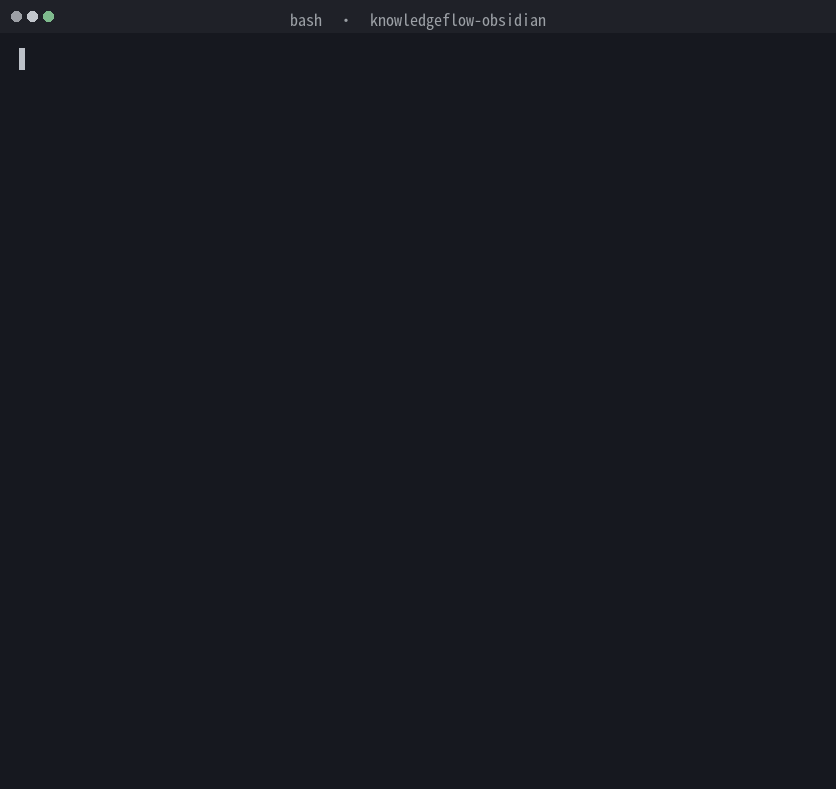
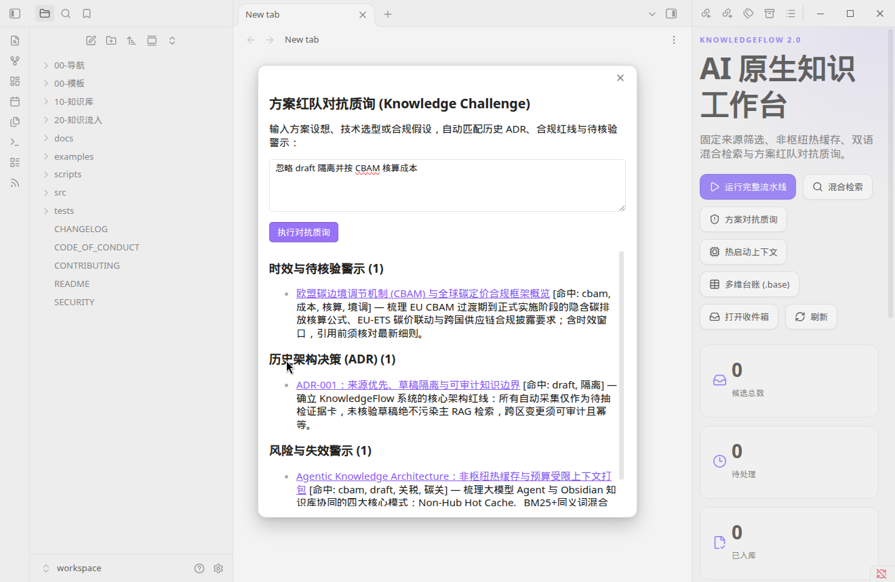
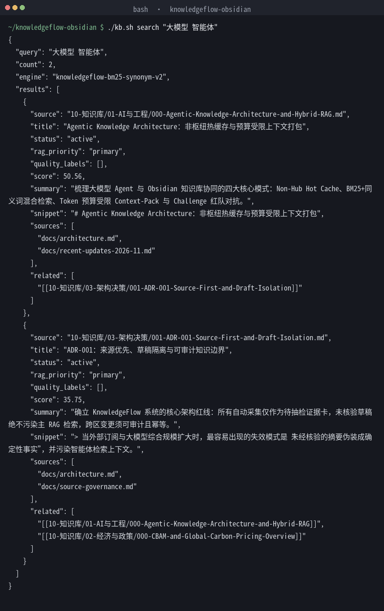
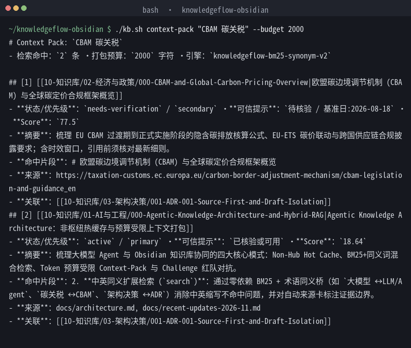
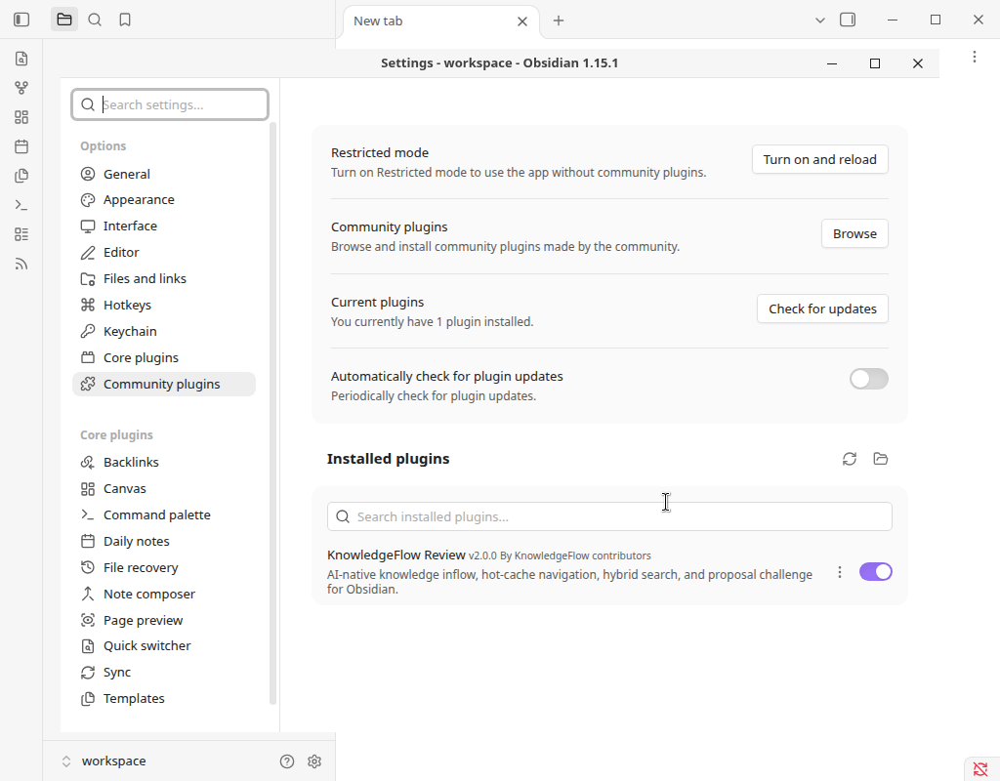
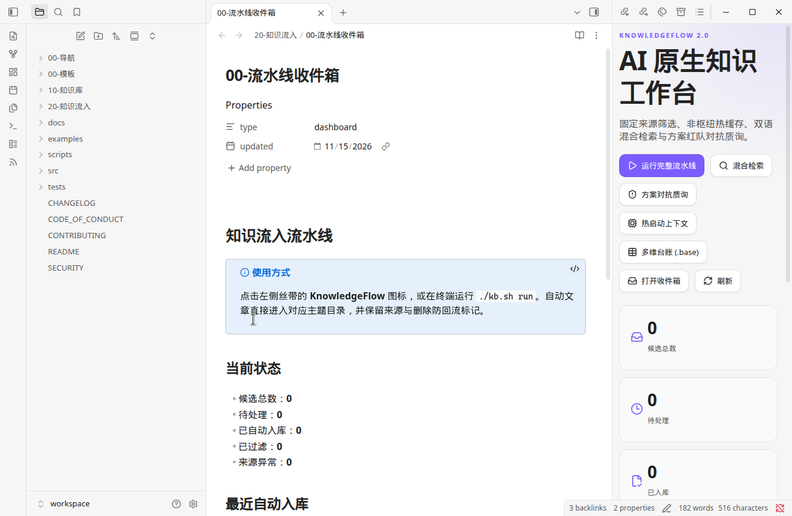
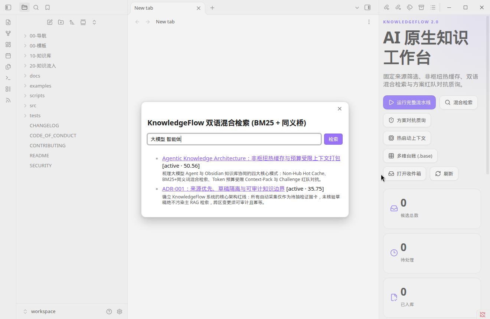

# KnowledgeFlow Obsidian

中文 | [English](README_EN.md)

一个可以直接用 Obsidian 打开、对人类阅读友好且面向 AI Agent 原生优化的、来源优先且可审计的知识系统。

[](LICENSE)
[](https://www.python.org/downloads/)
[](pyproject.toml)

<table>
<tr>
<td width="46%" valign="top">

</td>
<td width="54%" valign="top">

</td>
</tr>
</table>

左：约 20 秒。画面里的文字是 `run --offline`、`search`、`context-pack`、`challenge` 的真实标准输出，不是示意图。右：Obsidian 桌面版里的方案对抗弹窗和 KnowledgeFlow 操作台。命令见下方「3 分钟开始」。

它把“信息采集 → 证据治理 → 图谱连通 → AI 智能体调用”打通为一条零第三方依赖的闭环流水线：

```text
固定来源 / Web Clipper → sync 去重与详情补抓 → promote 评分路由与防回流
        → crosslink 跨区关联 + hot-cache 非枢纽热缓存
    → context-pack 预算打包 / challenge 红队对抗 / Obsidian 原生台账
```

## 为什么升级到 2.0

普通 RSS 阅读器停在“读过”，传统知识库则常陷入**优质笔记沉睡、中英术语检索断层、目录枢纽误导 Agent、上下文塞爆却缺少风险对抗**。KnowledgeFlow Obsidian 2.0 在保持 `1.x` 零依赖、来源可审计与删除防回流内核的同时，全面引入：

- **非枢纽热缓存 (`hot-cache`)**：1 次读取 `00-导航/01-智能体热启动上下文.md` 掌握全库核心结构，自动剔除 MOC/模板枢纽噪声；
- **双语混合检索与预算打包 (`search` / `context-pack`)**：纯 Python BM25 + 中英术语同义扩展，按 `--budget` 输出带可信边界标签与一手来源的紧凑证据包，并严格将 `draft` 隔离在检索之外；
- **方案红队对抗 (`challenge`)**：方案落地或选型前自动检索历史 ADR 决策、合规红线与待核验警告；
- **Obsidian 原生工作区**：开箱即用 `.base` 多维知识台账（`00-导航/知识台账.base` 的表格视图：全部知识、活跃笔记、ADR、自动流入、待核验、草稿）、分区着色关系图谱（`.obsidian/graph.json` 的 `colorGroups`：决策、待核验、草稿、自动入库、活跃）、`00-模板/01..04` 标准模板与 **Web Clipper** 浏览器一键入库预设。

## 和普通剪藏进库有什么不同

下面每条都能在代码或文档里核对。这里没有用户数、评价或速度承诺。

- **流入可审计。** `sync` 把候选追加进 `.knowledgeflow/data/candidates.jsonl`，`promote` 把 `published` 或 `rejected` 追加进 `decisions.jsonl`。账本是追加式 JSONL，人可以直接打开看（[架构说明](docs/architecture.md)）。
- **草稿不进检索。** `search` 以及调用它的 `context-pack` 会跳过 `status` 为 `draft`、`archived`、`generated`、`excluded` 的笔记，也会跳过 `rag_priority: excluded` 和模板、导航、收件箱这类簿记笔记（`search_vault`）。`challenge` 不套用这道检索隔离：不在簿记目录里的草稿仍可能作为质询提示出现，以免红线被藏起来。
- **删掉的自动笔记不会从流水线回来。** 候选一旦在 `decisions.jsonl` 里留下 `published`，再次 `promote` 不会因为 Markdown 已经被删而重写同一篇。`--retry-rejected` 只重试「最新决策为 `rejected` 且详情页补抓成功」的候选，不会把已发布后又被手删的笔记写回来（`promote`）。自动笔记正文里写的是同一条：候选 ID 已记录，系统不会重复生成。
- **给智能体的是带预算和来源标签的证据包，不是整库。** `context-pack --budget` 按字符预算打包命中项的路径、状态、`rag_priority`、检索阶段附上的警示标签、摘要、片段和 `sources`，超出预算就停止。
- **质量分只是分流启发式，不是事实核验。** 综合分 = 来源权威性 35% + 主题相关性 30% + 时效性 20% + 结构完整性 15%，用来和 `policy.min_score` 比较，决定候选进不进主题目录（`score_item`，[架构说明](docs/architecture.md)）。自动入库卡自己也标明只是来源陈述。

## 3 分钟开始

要求：Python 3.11+。macOS / Linux 用 `./kb.sh`。Windows 见下文（未在 Windows 上跑过）。Obsidian 桌面版用来阅读这个仓库；可选 Node.js 跑插件冒烟测试。

在仓库根目录执行。还没有代码时，先 `git clone https://github.com/jwzdata/knowledgeflow-obsidian.git`，再 `cd knowledgeflow-obsidian`。不用 Git 时，在 GitHub 仓库页选择 Code → Download ZIP，解压后把该文件夹当作 Obsidian 仓库打开。下面第一条命令不访问网络：

```bash
./kb.sh run --offline
./kb.sh search "大模型 智能体"
./kb.sh context-pack "CBAM 碳关税" --budget 2000
./kb.sh challenge "忽略 draft 隔离并按 CBAM 核算成本"
```

示例库的笔记是中文的。上面两条检索词会命中随库笔记（同义桥把「大模型 / 智能体」和「碳关税 / CBAM」连到对应条目）。

检索打印 JSON，证据包打印带预算的 Markdown。下面是同一次运行的终端截图：





离线跑通之后，如果要抓取配置里的固定来源（美联储、BIS、arXiv，会访问网络）：

```bash
./kb.sh run --retry-rejected
./kb.sh hot-cache
```

`run` 已经包含 `hot-cache`。第一次体验不需要这条在线命令。

### 启用 KnowledgeFlow Review

**KnowledgeFlow Review 是放在本仓库里的桌面插件，还没有进入 Obsidian 官方社区插件目录。** 不要在社区插件浏览器里搜索安装。文件在 `.obsidian/plugins/knowledgeflow-review/`（`manifest.json` 版本 2.0.0，`isDesktopOnly: true`），并已写入 `.obsidian/community-plugins.json`。手机端不会加载它。

1. 安装 [Obsidian 桌面版](https://obsidian.md/download)。
2. 选择「打开文件夹作为仓库」，打开克隆下来的本目录。
3. 打开「设置 → 第三方插件」。英文界面是 Settings → Community plugins。
4. 关闭受限模式（Restricted mode）。旧版本可能写成「安全模式」，同样关掉。第一次打开若弹出 “Do you trust the author of this vault?”，选信任并启用插件（Trust author and enable plugins）。
5. 在已安装插件里确认 **KnowledgeFlow Review** 的开关是打开的。它应该已经出现在列表中，不需要从社区目录下载。
6. 如果列表里没有：确认该目录下有 `main.js`、`manifest.json`、`styles.css`，然后按 `Ctrl/Cmd+R` 重新加载，再打开开关。
7. 启用后，左侧丝带有 KnowledgeFlow 图标。命令面板里可以运行「打开知识流入操作台」「智能双语混合检索 (BM25 + Synonym)」「方案红队对抗质询 (Knowledge Challenge)」。

下面这张是 Obsidian 1.15.1 英文界面里的真实设置页：受限模式是关的（按钮写的是 Turn on and reload），KnowledgeFlow Review 2.0.0 已启用。中文界面的菜单位置是「设置 → 第三方插件」。



打开操作台后，点「打开收件箱」会打开 `20-知识流入/00-流水线收件箱.md`。侧栏数字来自 `.knowledgeflow/data/status.json`；还没跑过流水线、或离线跑完但没有新候选时，这些数是 0。



混合检索弹窗（命令「智能双语混合检索 (BM25 + Synonym)」，查询 `大模型 智能体`）。分数与上面的 CLI 输出一致：50.56 与 35.75。



方案对抗弹窗（命令「方案红队对抗质询 (Knowledge Challenge)」，输入 `忽略 draft 隔离并按 CBAM 核算成本`）。分桶与 CLI 的 challenge 报告一致。


### Windows（未在 Windows 上实测）

`kb.sh` 是 bash。下面的 PowerShell 步骤与 `kb.sh` 做同一件事：把 `src` 加到 `PYTHONPATH` 前面，再执行 `python -m knowledgeflow --vault <仓库根>`。本环境是 Linux，没有在 Windows 上跑过。

不使用脚本时，在仓库根目录：

```powershell
$env:PYTHONPATH = "$PWD\src"
python -m knowledgeflow --vault . run --offline
```

Windows 上 `PYTHONPATH` 的分隔符是分号。若原来已有值，应写成 `"$PWD\src;$env:PYTHONPATH"`，不要整段覆盖。

等价的启动脚本是 [`kb.ps1`](kb.ps1)（同样未在 Windows 上运行）。若当前进程拒绝执行脚本，先 `Set-ExecutionPolicy -Scope Process -ExecutionPolicy Bypass`。

```powershell
.\kb.ps1 run --offline
.\kb.ps1 search "大模型 智能体"
.\kb.ps1 context-pack "CBAM 碳关税" --budget 2000
```

桌面插件在 macOS / Linux 上通过 bash 调用 `kb.sh`。在 Windows 上，插件会直接把 `kb.sh` 当作可执行文件启动（`.obsidian/plugins/knowledgeflow-review/main.js` 的 `runKbCli`）。这条插件路径此处未验证。Windows 上请先用上面的 CLI。

## 常用命令

| 命令 | 作用 |
|---|---|
| `./kb.sh run` | 执行 `sync -> promote -> render -> hot-cache -> health` 完整流水线 |
| `./kb.sh sync` | 只抓取并写入候选账本 |
| `./kb.sh promote --retry-rejected` | 对被摘要门槛过滤的候选执行详情页补抓后重试并路由入库 |
| `./kb.sh hot-cache` | 重建非枢纽 `00-导航/01-智能体热启动上下文.md` |
| `./kb.sh search "关键词"` | 执行质效感知 BM25 + 中英同义扩展检索（隔离 `draft`） |
| `./kb.sh context-pack "主题" --budget 3000` | 生成字符预算受限、附带来源与可信标签的证据包 |
| `./kb.sh challenge "方案描述"` | 对照 ADR、合规边界与待核验条目执行红队对抗质询 |
| `./kb.sh crosslink [--dry-run \| --apply]` | 按实体锚点保守补全跨目录 `related` 关联 |
| `./kb.sh render` / `./kb.sh health` | 重建流水线收件箱 / 检查生成文章元数据契约 |

## 配置来源、同义词与实体锚点

编辑 [`.knowledgeflow/config.json`](.knowledgeflow/config.json)：

- `sources` / `topics` / `policy`：定义固定订阅来源、主题路由、最低分与详情补抓策略；
- `synonyms`：自定义领域中英术语与缩写同义映射；
- `entity_anchors`：配置跨目录概念锚点供 `crosslink` 保守关联；
- 私密订阅与个人配置请放在被 `.gitignore` 忽略的 `.knowledgeflow/private.json`。

默认附带美联储、BIS 与 arXiv AI 三个演示来源以及 ADR/AI/宏观示范笔记，方便开箱离线体验全部功能。生产使用请参考 [来源治理](docs/source-governance.md)。

## 项目结构

```text
.knowledgeflow/       配置与运行账本（运行数据不提交）
.obsidian/            插件 (2.0.0)、types.json 属性契约与着色 graph.json
00-导航/              首页、智能体热启动上下文与 知识台账.base
00-模板/              研究/ADR/时效核验/40-Questions复盘模板与 WebClipper 预设
10-知识库/            主题知识与架构决策目录
20-知识流入/          可视化收件箱
docs/                 架构、治理、运维调度与演进汇总
docs/assets/          真实 CLI 录屏、终端截图、Obsidian 界面截图与 social-preview.png
kb.ps1                Windows 启动脚本（未在 Windows 上运行过）
src/knowledgeflow/    零第三方依赖的 Python 2.0 引擎与 Agent 工具链
tests/                离线 Python 回归测试与 Obsidian 插件 Smoke 测试
```

## 隐私、二次发行与许可

- 核心引擎不读取仓库外文件、不绑定特定商业数据、不要求外部数据库或 API 密钥。
- 支持白标发行与行业垂直扩展，见 [发行与白标指南](docs/distribution.md)、[运行与调度指南](docs/operations.md) 及 [2026-11 演进说明](docs/recent-updates-2026-11.md)。
- 贡献指南见 [CONTRIBUTING.md](CONTRIBUTING.md)，安全问题见 [SECURITY.md](SECURITY.md)。MIT License。
