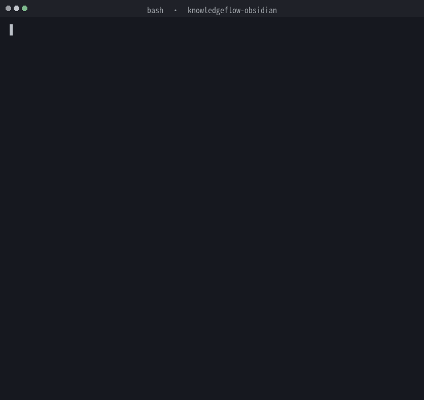
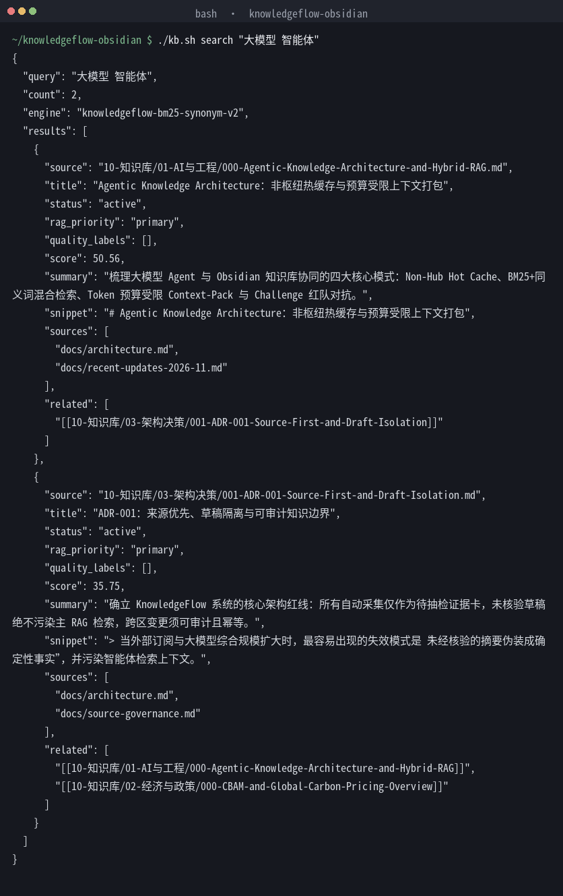
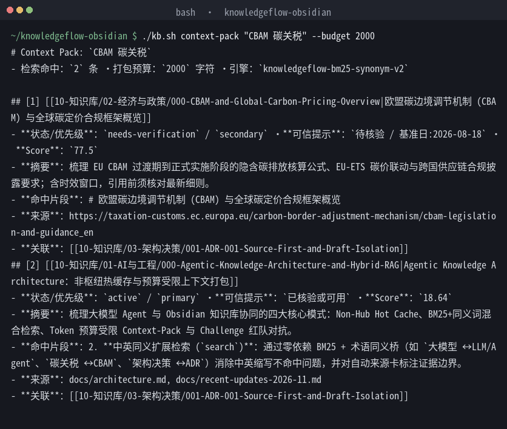
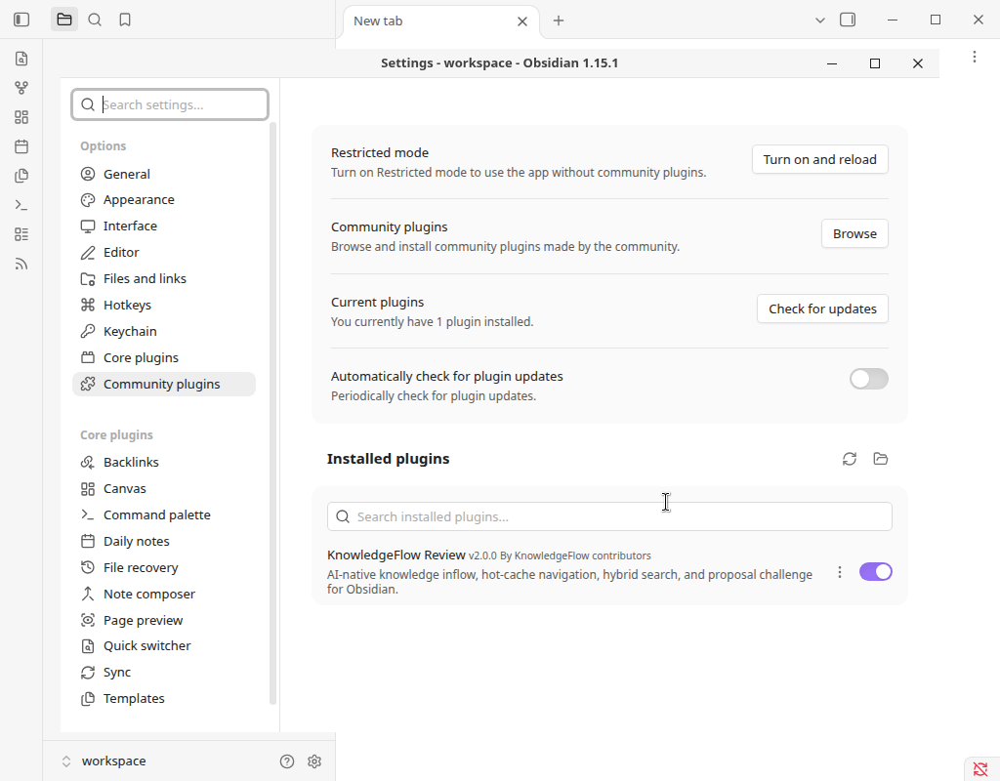
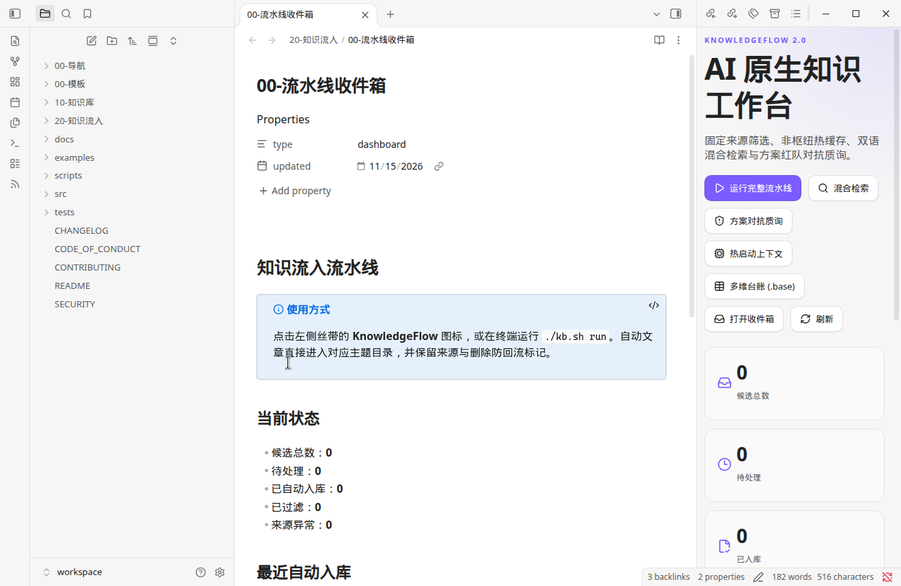
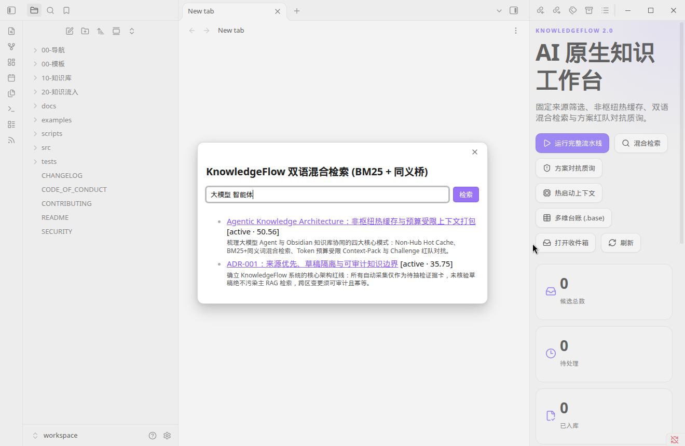
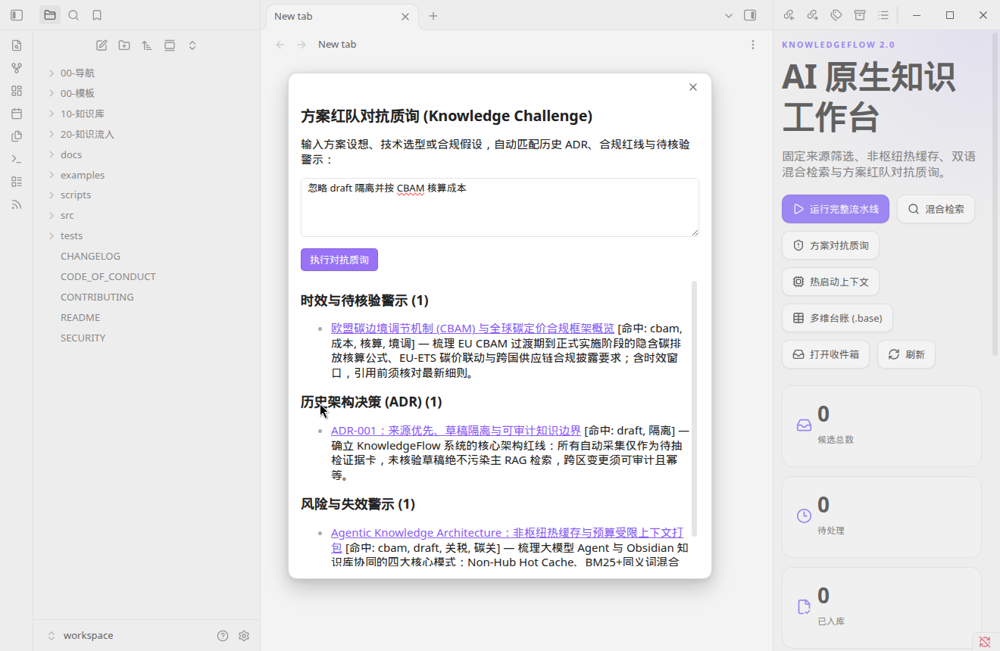

[中文](README.md) | English



About 20 seconds. The text is the real stdout of those four commands, not a mock. The commands are in “Start in 3 minutes” below.

# KnowledgeFlow Obsidian

An Obsidian vault you can open as a folder: readable for people, and built so an agent can call a source-first, auditable knowledge pipeline.

It connects capture, evidence handling, graph links, and agent calls in one loop. The core uses the Python standard library only:

```text
fixed sources / Web Clipper → sync (dedupe, optional detail fetch) → promote (score, route, no reflow)
        → crosslink + hot-cache (non-hub)
    → context-pack (budget) / challenge / Obsidian ledger
```

The sample notes in this repo are written in Chinese. The demo queries below are the ones that hit those notes. A synonym table bridges terms such as 大模型 / 智能体 and 碳关税 / CBAM, so the same commands work without translating the vault first.

## Why 2.0

An RSS reader stops at “I read it.” A usual vault often leaves good notes unread, misses a term because it was written in the other language, sends an agent into a map-of-content hub, and stuffs the whole folder into context with no check against past decisions. KnowledgeFlow Obsidian 2.0 keeps the 1.x rules — no third-party dependencies, auditable sources, deleted auto-notes do not come back — and adds:

- **Non-hub hot cache (`hot-cache`)**: one read of `00-导航/01-智能体热启动上下文.md` for the shape of the vault, with MOC and template hubs left out.
- **Bilingual search and a budgeted pack (`search` / `context-pack`)**: pure Python BM25 plus a Chinese–English synonym table. `--budget` caps the pack. Hits carry boundary labels and source fields. `draft` notes stay out of retrieval.
- **Proposal challenge (`challenge`)**: before you adopt a plan, match it against ADR notes, compliance lines, and notes that still need verification.
- **An Obsidian workspace that opens as-is**: a `.base` ledger, a colored graph, templates in `00-模板/01..04`, and a Web Clipper preset.

## What is different

Each point below is something you can check in the code or the docs. This README does not claim user counts, testimonials, or speed numbers.

- **Inflow is auditable.** `sync` appends candidates to `.knowledgeflow/data/candidates.jsonl`. `promote` appends `published` or `rejected` to `decisions.jsonl`. The ledgers are append-only JSONL ([architecture](docs/architecture.md)).
- **Drafts are not retrieved.** `search`, and `context-pack` which calls it, skips notes whose `status` is `draft`, `archived`, `generated`, or `excluded`. It also skips `rag_priority: excluded` and bookkeeping notes (templates, navigation, the inbox dashboard) in `search_vault`. `challenge` does not use that retrieval filter: a draft that is not bookkeeping can still show up as an advisory constraint, so a red line is not hidden.
- **A deleted auto-note does not come back through the pipeline.** Once `decisions.jsonl` records `published` for a candidate, a later `promote` will not write that note again just because the Markdown file was deleted. `--retry-rejected` only retries a candidate whose latest decision is `rejected` and whose detail-page fetch succeeded. It does not restore a note you published and then deleted (`promote`). The generated note says the same thing: the candidate id is recorded, and the system will not generate it again.
- **An agent gets a budgeted pack with source labels, not the whole vault.** `context-pack --budget` packs each hit’s path, status, `rag_priority`, any warning labels from search, a summary, a snippet, and `sources`, and stops when the character budget is used.
- **The quality score is a routing heuristic, not a truth check.** The score is source authority 35% + topic relevance 30% + freshness 20% + structure 15%. `promote` compares it with `policy.min_score` to decide whether a candidate is written into a topic folder (`score_item`, [architecture](docs/architecture.md)). An auto-ingested card says it is only a statement from the source.

## Start in 3 minutes

Requirements: Python 3.11+. On macOS or Linux, use `./kb.sh`. Windows is documented below and was not run on Windows here. Obsidian Desktop is how you read the vault. Node.js is only needed for the plugin smoke test.

Run this from the repository root. If you do not have the repo yet: `git clone https://github.com/jwzdata/knowledgeflow-obsidian.git`, then `cd knowledgeflow-obsidian`. The first command does not use the network:

```bash
./kb.sh run --offline
./kb.sh search "大模型 智能体"
./kb.sh context-pack "CBAM 碳关税" --budget 2000
./kb.sh challenge "忽略 draft 隔离并按 CBAM 核算成本"
```

`search` prints JSON. `context-pack` prints Markdown capped by the budget. These screenshots are from that same run:





After the offline path works, this online path fetches the configured sources (Federal Reserve, BIS, and arXiv in the default config). It uses the network:

```bash
./kb.sh run --retry-rejected
./kb.sh hot-cache
```

`run` already includes `hot-cache`. You do not need the online command for a first look.

### Enable KnowledgeFlow Review

**KnowledgeFlow Review is a desktop plugin shipped inside this repo. It is not in Obsidian’s official community plugin directory.** Do not search for it in the community plugin browser. The files are already at `.obsidian/plugins/knowledgeflow-review/` (`manifest.json` version 2.0.0, `isDesktopOnly: true`) and the id is already listed in `.obsidian/community-plugins.json`. The mobile apps will not load it.

1. Install [Obsidian Desktop](https://obsidian.md/download).
2. Choose “Open folder as vault” and select this repository.
3. Open Settings → Community plugins. In the Chinese UI that is 设置 → 第三方插件.
4. Turn off Restricted mode. Older builds label this Safe mode (安全模式). Turn that off too. If the first open asks “Do you trust the author of this vault?”, choose Trust author and enable plugins.
5. Under Installed plugins, confirm **KnowledgeFlow Review** is switched on. It should already be in the list. There is nothing to download from the community directory.
6. If it is missing, check that the plugin folder contains `main.js`, `manifest.json`, and `styles.css`, reload with `Ctrl/Cmd+R`, and turn the switch on.
7. The left ribbon then has a KnowledgeFlow icon. The command palette includes “打开知识流入操作台” (open the inflow desk), “智能双语混合检索 (BM25 + Synonym)”, and “方案红队对抗质询 (Knowledge Challenge)”.

This is a real Settings page from Obsidian 1.15.1 in English, with this vault open. Restricted mode is off (the button reads “Turn on and reload”). KnowledgeFlow Review 2.0.0 is enabled.



“打开收件箱” on the desk opens `20-知识流入/00-流水线收件箱.md`. The counts on the desk come from `.knowledgeflow/data/status.json`. They stay at 0 until a run has candidates. An offline run with an empty ledger also shows 0.



Hybrid search modal, command “智能双语混合检索 (BM25 + Synonym)”, query `大模型 智能体`. The scores match the CLI output above: 50.56 and 35.75.



Challenge modal, command “方案红队对抗质询 (Knowledge Challenge)”, proposal `忽略 draft 隔离并按 CBAM 核算成本`. The buckets match the CLI challenge report.



### Windows (not run on Windows)

`kb.sh` is bash. The PowerShell below does what `kb.sh` does: put `src` on `PYTHONPATH`, then run `python -m knowledgeflow --vault <repo root>`. That was checked by reading `kb.sh` and `src/knowledgeflow/__main__.py`. It was not executed on Windows.

Without the script, from the repository root:

```powershell
$env:PYTHONPATH = "$PWD\src"
python -m knowledgeflow --vault . run --offline
```

On Windows the `PYTHONPATH` separator is a semicolon. If the variable already has entries, prepend with `"$PWD\src;$env:PYTHONPATH"` instead of replacing it.

[`kb.ps1`](kb.ps1) is the same steps in a script, also not run on Windows. If the current process blocks scripts, run `Set-ExecutionPolicy -Scope Process -ExecutionPolicy Bypass` first.

```powershell
.\kb.ps1 run --offline
.\kb.ps1 search "大模型 智能体"
.\kb.ps1 context-pack "CBAM 碳关税" --budget 2000
```

On macOS and Linux the desktop plugin calls `kb.sh` through bash. On Windows, `runKbCli` in `.obsidian/plugins/knowledgeflow-review/main.js` executes `kb.sh` as the program. That plugin path was not verified here. Use the CLI above on Windows.

## Commands

| Command | What it does |
|---|---|
| `./kb.sh run` | `sync -> promote -> render -> hot-cache -> health` |
| `./kb.sh sync` | Fetch trusted sources into the candidate ledger only |
| `./kb.sh promote --retry-rejected` | Re-fetch detail pages for candidates rejected for a short summary, then route again |
| `./kb.sh hot-cache` | Rebuild the non-hub note `00-导航/01-智能体热启动上下文.md` |
| `./kb.sh search "query"` | BM25 plus Chinese–English synonyms. `draft` notes are excluded |
| `./kb.sh context-pack "topic" --budget 3000` | A character-budgeted pack with source fields and boundary labels |
| `./kb.sh challenge "proposal"` | Match a proposal against ADRs, compliance lines, and notes that need verification |
| `./kb.sh crosslink [--dry-run \| --apply]` | Conservative cross-folder `related` links from entity anchors |
| `./kb.sh render` / `./kb.sh health` | Rebuild the inbox / check generated-note metadata |

## Sources, synonyms, and entity anchors

Edit [`.knowledgeflow/config.json`](.knowledgeflow/config.json):

- `sources` / `topics` / `policy`: fixed feeds, topic routing, minimum score, and detail-page fetch.
- `synonyms`: Chinese–English terms and abbreviations.
- `entity_anchors`: concepts `crosslink` may relate across folders.
- Private feeds and personal overrides go in `.knowledgeflow/private.json`, which `.gitignore` excludes.

The default config ships three demo feeds (Federal Reserve, BIS, arXiv AI) plus sample ADR, AI, and macro notes, so the offline commands above have something to return. For a real deployment, read [source governance](docs/source-governance.md).

## Layout

```text
.knowledgeflow/       config and runtime ledgers (runtime data is not committed)
.obsidian/            plugin (2.0.0), types.json, colored graph.json
00-导航/              home, agent hot cache, 知识台账.base
00-模板/              research / ADR / verification / 40-Questions templates, Web Clipper preset
10-知识库/            topic notes and architecture decisions
20-知识流入/          pipeline inbox
docs/                 architecture, governance, operations, release notes
docs/assets/          real CLI recording, terminal shots, Obsidian screenshots
kb.ps1                Windows launcher (not run on Windows)
src/knowledgeflow/    Python 2.0 engine and agent tools, standard library only
tests/                offline Python tests and the Obsidian plugin smoke test
```

## Privacy, redistribution, license

- The core does not read files outside the vault, does not depend on a commercial dataset, and does not need an external database or an API key.
- White-label and vertical forks: [distribution](docs/distribution.md), [operations](docs/operations.md), and the [2026-11 notes](docs/recent-updates-2026-11.md).
- [CONTRIBUTING.md](CONTRIBUTING.md). Security reports: [SECURITY.md](SECURITY.md). MIT License.
